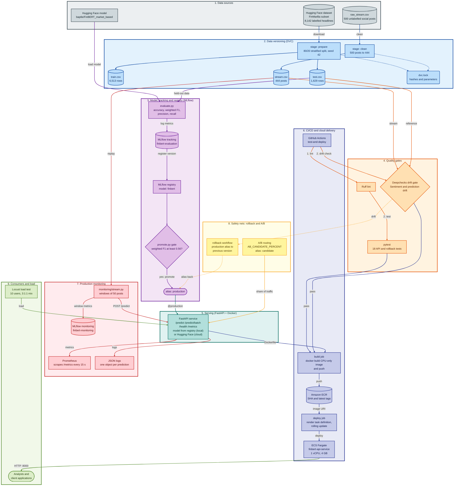

# Financial News Sentiment MLOps

**A real-time financial news sentiment service with a complete, automated MLOps stack.** It serves a pre-trained FinBERT model through a validated REST API and wraps it in data versioning, a model registry with a promotion gate, drift-gated CI/CD to AWS, and production monitoring.

[](https://github.com/eaamankwah/financial-news-sentiment-mlops/actions/workflows/ci-cd.yml)


---

## Table of contents

- [Overview](#overview)
- [Key results](#key-results)
- [Architecture](#architecture)
- [Repository structure](#repository-structure)
- [Dataset](#dataset)
- [Quick start](#quick-start)
- [API reference](#api-reference)
- [Configuration](#configuration)
- [Data versioning with DVC](#data-versioning-with-dvc)
- [Model evaluation, registry and promotion](#model-evaluation-registry-and-promotion)
- [Testing and quality gates](#testing-and-quality-gates)
- [Containers](#containers)
- [CI/CD pipeline](#cicd-pipeline)
- [Deploying to AWS](#deploying-to-aws)
- [Production monitoring](#production-monitoring)
- [Standout features](#standout-features)
- [Limitations and roadmap](#limitations-and-roadmap)
- [Troubleshooting](#troubleshooting)
- [References](#references)
- [License](#license)

---

## Overview

Financial desks and research platforms need a machine-readable sentiment signal within seconds of a headline appearing. A model file on a laptop does not provide that. This project closes the gap between a trained model and a dependable service.

It does **not** train a new model. It operationalises [`baptle/FinBERT_market_based`](https://huggingface.co/baptle/FinBERT_market_based), a FinBERT variant fine-tuned on headlines labelled from next-day market reactions, and builds everything around it:

| Capability | Implementation |
| --- | --- |
| Reproducible data | DVC pipeline (`dvc.yaml`, `dvc.lock`, `params.yaml`) |
| Experiment tracking and registry | MLflow with a `production` alias and an F1 promotion gate |
| Prediction service | FastAPI with strict validation, health checks and structured logs |
| Containerisation | CPU-only Docker image and Docker Compose with Prometheus |
| Quality gates | Ruff, pytest (18 tests), Deepchecks drift gate |
| Delivery | GitHub Actions to Amazon ECR and ECS Fargate |
| Monitoring | Prometheus metrics, JSON logs, windowed sentiment statistics in MLflow |
| Safety nets | Automatic rollback on drift, A/B routing to a candidate model |

---

## Key results

| Measure | Result |
| --- | --- |
| Weighted F1 on 1,629 held-out headlines (gate: 0.56) | **0.5901** |
| Accuracy / weighted precision / weighted recall | 0.6384 / 0.6111 / 0.6384 |
| Automated tests | 18 of 18 passing, Ruff clean |
| Load test (10 users, 30 s) | 134 requests, **0 failures**, median 30 ms, p95 120 ms |
| Drift gate (Sentiment property / prediction) | 0.291 (limit 0.5) / 0.232 (limit 0.6), passed |
| ECS deployment | Rolling update completed in 1 min 22 s, 1 of 1 tasks running |
| First request after start-up | about 1 s (model warm-up), then about 40 ms |

> **Read this before relying on the model.** The neutral class is recognised poorly (recall 0.14), and the model predicts positive for roughly 55% of headlines against a true share of 43%. Treat the output as a research signal, not investment advice. See [Limitations and roadmap](#limitations-and-roadmap).

---

## Architecture

The diagram follows the data science flow from raw data to a monitored production service. Each colour is one functional group.



**How to read it**

| Colour | Group | What happens |
| --- | --- | --- |
| Grey | Data sources | The labelled Hugging Face dataset, the unlabelled social posts and the pre-trained model |
| Blue | Data versioning | DVC stages produce `train.csv`, `test.csv` and `stream.csv`, pinned by hashes in `dvc.lock` |
| Purple | Model and registry | `evaluate.py` logs metrics to MLflow, registers a version, and `promote.py` moves the `production` alias only if weighted F1 is at least 0.56 |
| Orange | Quality gates | Ruff, pytest and the Deepchecks drift gate must pass before anything is built |
| Teal | Serving | FastAPI loads `models:/finbert@production` locally, or the Hugging Face model in the cloud |
| Indigo | CI/CD and cloud | GitHub Actions builds the image, pushes it to ECR and rolls it out to ECS Fargate |
| Red | Monitoring | Prometheus scrapes `/metrics`; the stream monitor logs 50-post windows to MLflow |
| Yellow | Safety nets | A drift failure moves the alias back; A/B routing sends a share of traffic to a candidate |
| Green | Consumers and load | Client applications and the Locust load test |

### CI/CD job graph

```mermaid
flowchart LR
  PUSH(["git push to main<br/>(docs-only pushes ignored)"]):::trig
  LINT["lint<br/>ruff check"]:::lint
  TEST["test<br/>pytest tests/<br/>MODEL_SOURCE=huggingface"]:::test
  DCJ["deepchecks<br/>dvc repro + drift gate<br/>uploads drift-report"]:::dc
  BUILD["build<br/>ECR login, docker build,<br/>push SHA + latest"]:::build
  DEPLOY["deploy<br/>describe, render, deploy<br/>wait for service stability"]:::deploy
  LIVE(["ECS Fargate<br/>service stable"]):::live
  RB["rollback-on-drift<br/>workflow_run"]:::rb
  ALIAS(["MLflow alias production<br/>previous version"]):::alias
  PUSH --> LINT
  LINT --> TEST
  LINT --> DCJ
  TEST -->|pass| BUILD
  DCJ -->|exit 0| BUILD
  BUILD --> DEPLOY
  DEPLOY --> LIVE
  DCJ -.->|exit 1: drift_failed true| RB
  RB -.->|scripts/rollback.py| ALIAS
  classDef trig fill:#CFD8DC,stroke:#37474F,stroke-width:2px,color:#102027
  classDef lint fill:#FFE0B2,stroke:#E65100,stroke-width:2px,color:#5D2300
  classDef test fill:#BBDEFB,stroke:#0D47A1,stroke-width:2px,color:#0B2A5B
  classDef dc fill:#E1BEE7,stroke:#6A1B9A,stroke-width:2px,color:#3A0F55
  classDef build fill:#B2DFDB,stroke:#00695C,stroke-width:2px,color:#00332C
  classDef deploy fill:#C5CAE9,stroke:#283593,stroke-width:2px,color:#0F1747
  classDef live fill:#DCEDC8,stroke:#558B2F,stroke-width:2px,color:#1F3A0B
  classDef rb fill:#FFCDD2,stroke:#C62828,stroke-width:2px,color:#5C0A0A
  classDef alias fill:#FFF59D,stroke:#F9A825,stroke-width:2px,color:#4D3A00
  linkStyle 0,1,2 stroke:#37474F,stroke-width:2px
  linkStyle 3,4 stroke:#00695C,stroke-width:2px
  linkStyle 5,6 stroke:#283593,stroke-width:2px
  linkStyle 7,8 stroke:#C62828,stroke-width:2px
```



### Design decisions

- **Aliases, not stages.** Promotion, rollback and A/B routing are all expressed as reading or moving an MLflow alias (`production`, `candidate`).
- **Switchable model source.** `MODEL_SOURCE=mlflow` resolves the registry; `MODEL_SOURCE=huggingface` loads the model directly, which is what the cloud container uses because no MLflow server exists in AWS.
- **One configuration file.** Split ratio, cleaning limits, the F1 gate and both drift thresholds live in `params.yaml`.
- **Exit-code contract for the drift gate.** `0` passed, `1` drift detected (triggers rollback), `2` the check itself failed (never triggers rollback).

---

## Repository structure

```text
.
|-- app/
|   |-- main.py                  # FastAPI app, metrics, JSON logging, A/B routing
|   `-- utils.py                 # model loading (MLflow or Hugging Face)
|-- scripts/
|   |-- load_data.py             # DVC stage: download dataset, stratified split
|   |-- clean_data.py            # DVC stage: clean the raw social posts
|   |-- smoke_test.py            # one-off model download and config patch
|   |-- evaluate.py              # metrics, MLflow logging, model registration
|   |-- promote.py               # F1 gate and production alias
|   |-- rollback.py              # move the alias to the previous version
|   |-- run_deepchecks.py        # drift gate with exit-code contract
|   |-- locustfile.py            # load test (3:1:1 task mix)
|   `-- measure_image_sizes.sh   # build baseline and optimised images, print sizes
|-- monitoring/stream.py         # replay the stream through the API in windows
|-- tests/                       # 18 tests (API, A/B routing, rollback)
|-- data/raw_stream.csv          # 500 unlabelled social posts (DVC input)
|-- .github/workflows/
|   |-- ci-cd.yml                # lint, test, deepchecks, build, deploy
|   |-- rollback.yml             # automatic rollback on drift
|   `-- image-size.yml           # manual image-size comparison
|-- dvc.yaml, dvc.lock, params.yaml
|-- Dockerfile                   # production image (CPU-only)
|-- Dockerfile.baseline          # unoptimised image for size comparison
|-- docker-compose.yml           # API + Prometheus
|-- prometheus.yml               # scrape configuration
|-- requirements.txt             # development and CI dependencies
|-- requirements-prod.txt        # runtime-only dependencies for the image
|-- ruff.toml                    # pinned lint rule set
`-- .env.example
```

---

## Dataset

**Labelled data:** [`baptle/financial_headlines_market_based`](https://huggingface.co/datasets/baptle/financial_headlines_market_based) (MIT licence), a subset of the FinMarBa dataset.

| Item | Value |
| --- | --- |
| Rows | 8,142 headlines (about 1.2 MB) |
| Columns | `Date`, `Title`, `Tickers`, `Sentiment`, `Global Sentiment`, `Pct_Change` |
| Labels | `1` positive, `0` neutral, `-1` negative (mapped to words in `load_data.py`) |
| Split | Stratified 80/20, seed 42: 6,513 train and 1,629 test rows |
| Test balance | 702 positive (43.1%), 496 negative (30.5%), 431 neutral (26.5%) |

Headlines were extracted from Bloomberg Market Wraps with GPT-4 and labelled from the **next-day price move** of the related tickers: positive above the 60th percentile of the previous five years of returns, negative below the 30th percentile, neutral otherwise. There is no human annotation.

**Simulated production stream:** `data/raw_stream.csv` holds 500 unlabelled social media posts. `clean_data.py` removes links, mentions, hashtag symbols and non-ASCII characters, drops duplicates, requires at least 10 words and keeps posts containing one of 40 finance keywords. The funnel is **500 to 490 to 455 to 444** posts. Because the stream has no labels, it is used for monitoring and drift checks, not for accuracy.

---

## Quick start

**Prerequisites:** Python 3.12, Git. Docker and the AWS CLI are needed only for the container and cloud sections.

### 1. Install

```bash
git clone https://github.com/eaamankwah/financial-news-sentiment-mlops.git
cd financial-news-sentiment-mlops
python3 -m venv .venv && source .venv/bin/activate
pip install -r requirements.txt
cp .env.example .env
```

Edit `.env` so that these keys have these values:

```dotenv
MLFLOW_TRACKING_URI="http://localhost:5000"
MLFLOW_EXPERIMENT_NAME="finbert-evaluation"
MODEL_NAME="finbert"
MODEL_STAGE=production        # the alias that promote.py sets (not "dev")
MODEL_SOURCE=mlflow           # use "huggingface" to skip the registry
```

> Empty values in `.env` fall back to safe defaults (`finbert-evaluation`, `finbert`, `production`).

### 2. Download the model once

```bash
python scripts/smoke_test.py
```

This downloads FinBERT and patches its `config.json`, whose label map is stored as floating-point keys.

### 3. Start MLflow (second terminal)

```bash
source .venv/bin/activate
mlflow server --port 5000 --host 0.0.0.0 --allowed-hosts "*"
```

### 4. Build the data, evaluate and promote

```bash
dvc repro                      # prepare + clean stages
python scripts/evaluate.py     # logs metrics, registers model "finbert"
python scripts/promote.py      # sets alias "production" if weighted F1 >= 0.56
```

Expected `promote.py` output: `Production alias set to finbert version 1`, or `Model NOT promoted: f1_weighted ... is below the threshold 0.5600`.

### 5. Run the API

```bash
python -m app.main             # http://localhost:8000  (docs at /docs)
# equivalent: uvicorn app.main:app --host 0.0.0.0 --port 8000
```

```bash
curl -s localhost:8000/health
curl -s -X POST localhost:8000/predict -H 'Content-Type: application/json' \
     -d '{"text":"Company earnings exceeded expectations"}'
```

### 6. Check quality

```bash
ruff check app/ scripts/ tests/
MODEL_SOURCE=huggingface pytest tests/ -v
python scripts/run_deepchecks.py
```

---

## API reference

| Method and path | Purpose | Status codes |
| --- | --- | --- |
| `GET /health` | Liveness and model readiness | `200`, `503` |
| `POST /predict` | Score one headline | `200`, `422`, `503` |
| `POST /predict/batch` | Score a list of headlines | `200`, `422`, `503` |
| `GET /metrics` | Prometheus exposition | `200` |
| `GET /docs` | Interactive OpenAPI documentation | `200` |

**Single prediction**

```bash
curl -s -X POST localhost:8000/predict -H 'Content-Type: application/json' \
     -d '{"text":"Company earnings exceeded expectations"}'
```

The response has four fields:

| Field | Type | Meaning |
| --- | --- | --- |
| `text` | string | The input headline |
| `sentiment` | string | `positive`, `neutral` or `negative` |
| `confidence` | float | Softmax score of the predicted label, between 0 and 1 |
| `latency_ms` | float | Wall-clock time of the model call in milliseconds |

A real response captured from the running service for the test text `"string"` (the OpenAPI default):

```json
{
  "text": "string",
  "sentiment": "positive",
  "confidence": 0.5626457333564758,
  "latency_ms": 1021.8935970005987
}
```

That first call took about one second because of model warm-up; the same text sent moments later through `/predict/batch` took 38.0 ms.

**Batch prediction**

```bash
curl -s -X POST localhost:8000/predict/batch -H 'Content-Type: application/json' \
     -d '{"texts":["Profits rise","Shares fall"]}'
```

The response is a list with one object per input, in the same order.

**Behaviour to know about**

- An empty or whitespace-only `text`, an empty `texts` list, or any empty element returns `422`.
- If the model failed to load, `/health` and both prediction endpoints return `503` with `Model unavailable`. The container keeps running so the platform can see the failure.
- `confidence` is the softmax score of the top label. It is not calibrated.
- In a batch, every item carries the latency of the whole model call.
- Every prediction response includes an `X-Model-Variant` header (`production` or `candidate`).
- The first request after start-up pays a one-time warm-up cost of roughly one second.
- Inputs are truncated to 512 tokens.

---

## Configuration

### Environment variables

| Variable | Default | Purpose |
| --- | --- | --- |
| `MODEL_SOURCE` | `mlflow` | `mlflow` loads `models:/<MODEL_NAME>@<MODEL_STAGE>`; `huggingface` loads `HF_MODEL_ID` directly |
| `MODEL_NAME` | `finbert` | Registered model name |
| `MODEL_STAGE` | `production` | Registry alias to serve |
| `MLFLOW_TRACKING_URI` | `http://localhost:5000` | MLflow server (use `http://host.docker.internal:5000` from a container) |
| `MLFLOW_EXPERIMENT_NAME` | `finbert-evaluation` | Experiment used by `evaluate.py` and `promote.py` |
| `MLFLOW_MONITORING_EXPERIMENT` | `finbert-monitoring` | Experiment used by `monitoring/stream.py` |
| `HF_MODEL_ID` | `baptle/FinBERT_market_based` | Hugging Face model |
| `HF_DATASET_ID` | `baptle/financial_headlines_market_based` | Hugging Face dataset |
| `API_HOST`, `API_PORT` | `0.0.0.0`, `8000` | Bind address of `python -m app.main` |
| `AB_CANDIDATE_PERCENT` | `0` | Share (0 to 100) of traffic sent to the candidate model |
| `AB_CANDIDATE_URI` | `models:/finbert@candidate` | Candidate model location |
| `API_URL`, `WINDOW_SIZE`, `SLEEP_MS` | `http://localhost:8000`, `50`, `100` | Settings for `monitoring/stream.py` |

### `params.yaml`

| Section | Keys | Values |
| --- | --- | --- |
| `prepare` | `test_size`, `random_seed` | `0.2`, `42` |
| `clean` | `min_words`, `max_words` | `10`, `100` |
| `promote` | `f1_threshold` | `0.56` |
| `deepchecks` | property and prediction drift thresholds | `0.5`, `0.6` |

---

## Data versioning with DVC

`dvc.yaml` defines two stages:

| Stage | Command | Dependencies | Parameters | Outputs |
| --- | --- | --- | --- | --- |
| `prepare` | `python scripts/load_data.py` | `scripts/load_data.py` | `prepare.test_size`, `prepare.random_seed` | `data/train.csv`, `data/test.csv` |
| `clean` | `python scripts/clean_data.py` | `scripts/clean_data.py`, `data/raw_stream.csv` | `clean.min_words`, `clean.max_words` | `data/stream.csv` |

`dvc.lock` records the MD5 hash and size of every input and output together with the parameters of the last run. Rebuilding the stream gives hash `b08f1697...`, matching the lock file.

```bash
dvc repro      # runs only the stages whose inputs changed
dvc status     # "Data and pipelines are up to date"
```

The generated CSV files are kept out of Git (`data/.gitignore`). No DVC remote is configured, so collaborators and CI rebuild the data with `dvc repro`, which downloads the dataset from Hugging Face. See [Limitations](#limitations-and-roadmap).

---

## Model evaluation, registry and promotion

1. `evaluate.py` runs the model over `data/test.csv` (batch size 32, 512-token truncation), logs `accuracy`, `f1_weighted`, `precision_weighted` and `recall_weighted`, and registers the model as `finbert`.
2. `promote.py` reads `promote.f1_threshold` from `params.yaml`, finds the latest evaluation run and sets the `production` alias on its model version only if the F1 is high enough.
3. The API, rollback and A/B routing all resolve versions through aliases.

**Evaluation on 1,629 test headlines**

| Class | Precision | Recall | F1 | Support |
| --- | --- | --- | --- | --- |
| negative | 0.62 | 0.75 | 0.68 | 496 |
| neutral | 0.51 | **0.14** | 0.22 | 431 |
| positive | 0.67 | 0.86 | 0.75 | 702 |
| weighted average | 0.61 | 0.64 | 0.59 | 1,629 |

The test split is random and stratified. The authors of the dataset evaluate with a chronological split, so these figures are context rather than a like-for-like benchmark.

---

## Testing and quality gates

| Check | Command | Covers |
| --- | --- | --- |
| Lint | `ruff check app/ scripts/ tests/` | Style and import problems (`ruff.toml` pins the rule set) |
| API tests | `MODEL_SOURCE=huggingface pytest tests/ -v` | Validation, `422`/`503` paths, metrics, error counter, A/B routing |
| Rollback tests | included in `pytest` | Previous version, version gaps, nothing to roll back to, dry run |
| Drift gate | `python scripts/run_deepchecks.py` | Sentiment property drift and prediction drift, test split versus stream |
| Load test | `locust -f scripts/locustfile.py --host http://localhost:8000 --headless -u 10 -r 2 -t 30s` | Latency and failures under concurrent use |

**Drift gate exit codes:** `0` within limits, `1` drift detected, `2` the check could not run. The script always writes `drift_result.json`.

**Load test result:** 134 requests, no failures. Single predictions averaged 37 ms, batch predictions of four headlines averaged 115 ms and health checks 3 ms. Throughput of 4.7 requests per second reflects the think time of the simulated users, so it is not a capacity limit.

> `tests/conftest.py` ends the interpreter early to avoid a native-library crash at exit, which can hide pytest's final summary line. Use `-v` and check the exit code.

---

## Containers

```bash
docker compose up --build -d
docker compose ps
curl -s localhost:8000/health
```

| Service | Image | Port | Notes |
| --- | --- | --- | --- |
| `api` | built from `Dockerfile` | 8000 | Health check calls `/health` every 30 s with a 120 s start period |
| `prometheus` | `prom/prometheus:v2.53.0` | 9090 | Scrapes `api:8000/metrics` every 15 s |

The production image uses `python:3.12-slim`, installs only `requirements-prod.txt` with `pip install --no-cache-dir`, and copies only `app/`. It defaults to `MODEL_SOURCE=huggingface`; Compose reads `.env`, which overrides that default. `Dockerfile.baseline` installs the full `requirements.txt` with default wheels so that the sizes can be compared:

```bash
bash scripts/measure_image_sizes.sh      # or run the "image-size-report" workflow
```

> The `torch==2.4.1+cpu` wheel exists for x86-64 Linux. On an ARM build host, remove the `+cpu` suffix. `--no-cache-dir` must stay on the `pip` command line because pip rejects it inside a requirements file.

---

## CI/CD pipeline

`.github/workflows/ci-cd.yml` (workflow name `test-and-deploy`) runs five jobs:

| Job | Needs | What it does |
| --- | --- | --- |
| `lint` | none | `ruff check` |
| `test` | `lint` | installs dependencies, runs `pytest tests/` with `MODEL_SOURCE=huggingface` |
| `deepchecks` | `lint` | `dvc init --no-scm -f`, `dvc repro`, drift gate, uploads `drift-report` |
| `build` | `test`, `deepchecks` | ECR login, `docker build`, pushes `:<git sha>` and `:latest` |
| `deploy` | `build` | downloads the task definition, renders the new image, deploys, waits for stability |

**Triggers.** Pushes to `main` and manual runs. Documentation-only pushes (`**.md`, `docs/**`, `LICENSE`, `.gitignore`, `rollback.yml`, `image-size.yml`) are ignored; a push that also changes any other file runs the full pipeline. For a code push that should not deploy, include `[skip ci]` in the commit message.

**Repository secrets**

| Secret | Purpose |
| --- | --- |
| `AWS_ACCESS_KEY_ID`, `AWS_SECRET_ACCESS_KEY`, `AWS_SESSION_TOKEN` | AWS credentials (temporary lab credentials need refreshing) |
| `AWS_REGION` | AWS region |
| `ECR_REGISTRY` | `<account>.dkr.ecr.<region>.amazonaws.com` |
| `MLFLOW_TRACKING_URI` | MLflow server reachable from GitHub runners (rollback workflow only) |

> **Lesson learned.** GitHub redacts job outputs that contain a secret-derived value, so an image URI built from `ECR_REGISTRY` arrived empty in the `deploy` job. The registry address is now resolved inside the `deploy` job with `amazon-ecr-login`.

---

## Deploying to AWS

Create the resources once; the pipeline owns every release afterwards. Replace the placeholders.

```bash
export AWS_REGION=us-east-1
ACCOUNT_ID=$(aws sts get-caller-identity --query Account --output text)
VPC_ID=$(aws ec2 describe-vpcs --filters Name=isDefault,Values=true --query 'Vpcs[0].VpcId' --output text)
SUBNET_ID=$(aws ec2 describe-subnets --filters Name=vpc-id,Values=$VPC_ID --query 'Subnets[0].SubnetId' --output text)

aws ecr create-repository --repository-name finbert-api
SG_ID=$(aws ec2 create-security-group --group-name finbert-sg --description "finbert api" \
        --vpc-id $VPC_ID --query GroupId --output text)
aws ec2 authorize-security-group-ingress --group-id $SG_ID --protocol tcp --port 8000 --cidr 0.0.0.0/0
aws ecs create-cluster --cluster-name finbert-cluster
```

Create `taskdef.json` (Fargate, 1 vCPU, 4 GB, container named `finbert-api` on port 8000, `MODEL_SOURCE=huggingface`), then:

```bash
aws ecs register-task-definition --cli-input-json file://taskdef.json
aws ecs create-service --cluster finbert-cluster --service-name finbert-api-service \
  --task-definition finbert-api --desired-count 1 --launch-type FARGATE \
  --network-configuration "awsvpcConfiguration={subnets=[$SUBNET_ID],securityGroups=[$SG_ID],assignPublicIp=ENABLED}"
```

Add the repository secrets, then push to `main`.

- The container listens on **8000**; open that port (or put a load balancer listener on 80 in front).
- Allow at least 1 vCPU and 4 GB. The API process used about 504 MiB with the model loaded.
- The task needs outbound internet access to download the model at start-up.
- `taskdef.json` contains your account ID and role ARN. Keep it out of public repositories.

---

## Production monitoring

**Prometheus (`/metrics`)**

| Metric | Type | Labels |
| --- | --- | --- |
| `prediction_requests_total` | Counter | `sentiment` |
| `prediction_latency_ms` | Histogram (5 to 10,000 ms buckets) | none |
| `prediction_errors_total` | Counter | none |
| `ab_predictions_total` | Counter | `variant`, `sentiment` |
| `ab_prediction_latency_ms` | Histogram | `variant` |
| `ab_prediction_confidence` | Histogram | `variant` |

Useful queries: `sum by (sentiment) (rate(prediction_requests_total[5m]))` and `histogram_quantile(0.95, sum by (le) (rate(prediction_latency_ms_bucket[5m])))`. The Prometheus UI is at <http://localhost:9090>; **Status > Targets** should show `finbert-api` as UP.

**Structured logs.** One JSON object per line on standard output with `timestamp`, `level` and `message`, plus `variant`, `sentiment`, `confidence` and `latency_ms` for predictions.

**Windowed model statistics.** `monitoring/stream.py` replays the 444 cleaned posts through `/predict` in windows of 50 and logs them to the MLflow experiment `finbert-monitoring`, using the window index as the step:

```bash
python monitoring/stream.py
```

Logged metrics: `pct_positive`, `pct_negative`, `pct_neutral`, `avg_confidence`, `avg_latency_ms`, `failed_requests`, and per-variant `production_*` / `candidate_*` values. With 444 posts this gives 8 full windows and one of 44 posts (steps 1 to 9).

There are no alerting rules or dashboards yet. See the roadmap.

---

## Standout features

### Automatic rollback on drift

If the `deepchecks` job exits with code `1`, it uploads `drift_result.json` as the `drift-report` artifact. The `rollback-on-drift` workflow then downloads it and, only when `drift_failed` is `true`, runs `scripts/rollback.py`, which moves `production` to the greatest earlier registered version. It refuses to act when no earlier version exists. Test failures, lint errors and infrastructure errors (exit code `2`) never trigger a rollback.

```bash
python scripts/rollback.py --dry-run     # show what would happen
python scripts/rollback.py               # do it
gh workflow run rollback-on-drift.yml    # manual trigger
```

It needs the `MLFLOW_TRACKING_URI` secret, an MLflow server reachable from GitHub runners, and fires only from the default branch.

### CPU-only production image

`requirements-prod.txt` pulls PyTorch from the CPU wheel index (`torch==2.4.1+cpu`), avoiding the CUDA libraries in the default wheel. Measure the effect with `scripts/measure_image_sizes.sh` or the manual `image-size-report` workflow.

### A/B routing

```bash
python -c "import mlflow; from mlflow.tracking import MlflowClient as C; \
mlflow.set_tracking_uri('http://localhost:5000'); \
C().set_registered_model_alias('finbert','candidate','2')"

AB_CANDIDATE_PERCENT=20 python -m app.main
```

Routing is random per request, re-read on every request, and not sticky per user. The candidate loads at start-up; if it cannot load, the API logs the failure and serves production only. Compare variants with the `X-Model-Variant` header, the `ab_*` Prometheus series and the `candidate_*` MLflow metrics.

---

## Limitations and roadmap

| Limitation | Impact | Next step |
| --- | --- | --- |
| Neutral recall is 0.14 | Skewed sentiment signal | Re-balance or fine-tune, add a per-class recall gate |
| Random split, not chronological | F1 may be optimistic | Add a time-based evaluation |
| No labels in production | Real accuracy unknown | Label a sample of live posts |
| Drift thresholds set by hand | Gradual drift may pass | Calibrate on history |
| No auth, TLS or load balancer; task health status unknown; alarms off | Exposure, slow failure detection | ALB, HTTPS, API keys, container health check, alarms |
| No DVC remote; dataset revision not pinned | Reproducibility depends on upstream | Add a remote, pin the Hugging Face revision |
| Rollback, A/B and image-size comparison not yet demonstrated live | Unproven end to end | Run each once and record the result |
| Labels come from price moves | Statistical association, not causal effect of news | Combine with other evidence |

Roadmap: harden the deployment, add alerting and dashboards, improve the neutral class, and build a small labelled sample of live posts so accuracy can be monitored directly.

---

## Troubleshooting

| Symptom | Cause and fix |
| --- | --- |
| `/health` returns `503` after start | The model is still loading, or `models:/finbert@production` does not exist. Run `promote.py` and check `MODEL_STAGE=production` |
| `Missing value for required parameter 'experiment_name'` | Empty values copied from `.env.example`; update to the latest scripts, which apply defaults |
| `Candidate load failed; serving production only` | The `candidate` alias is missing or not a transformers model |
| `Cannot initialize repo with --no-scm and --subdir` | Never combine those flags. Locally use `dvc init --subdir`; in CI `dvc init --no-scm -f` |
| `no such option: --no-cache-dir` | Remove it from the requirements file and keep it on the `pip install` command |
| `Deepchecks could not run` (exit 2) | Install `fasttext-wheel` and allow internet access for the language-detection model |
| Deepchecks exits `1` on real data | The gate is working. Review `drift_result.json`, then fix the data or tune `deepchecks.*` in `params.yaml` |
| `pytest` prints no summary line | `conftest.py` exits early. Use `-v` and `echo $?` |
| No `torch>=2.4` on an Intel Mac | PyTorch publishes no macOS x86 wheels after 2.2.2. Use an uncommitted local requirements file with `torch<=2.2.2`, `numpy<2` and a compatible `transformers` |
| ECS task keeps restarting | Image not pushed yet, less than 4 GB memory, no outbound internet, or port 8000 closed in the security group |
| Deployment stays pending | Refresh the temporary AWS credentials and secrets, including `AWS_SESSION_TOKEN` |

---

## References

1. Araci, D. (2019). *FinBERT: Financial Sentiment Analysis with Pre-trained Language Models.* [arXiv:1908.10063](https://arxiv.org/abs/1908.10063)
2. Lefort, B. et al. (2024). *Optimizing Performance: How Compact Models Match or Exceed GPT's Classification Capabilities through Fine-Tuning.* [arXiv:2409.11408](https://arxiv.org/pdf/2409.11408)
3. Lefort, B. et al. (2025). *FinMarBa: A Market-Informed Dataset for Financial Sentiment Classification.* IJCAI 2025 FinLLM Workshop. [arXiv:2507.22932](https://arxiv.org/pdf/2507.22932)
4. [`baptle/FinBERT_market_based`](https://huggingface.co/baptle/FinBERT_market_based) (model) and [`baptle/financial_headlines_market_based`](https://huggingface.co/datasets/baptle/financial_headlines_market_based) (dataset), Hugging Face.
5. Sculley, D. et al. (2015). *Hidden Technical Debt in Machine Learning Systems.* [NeurIPS 28](https://proceedings.neurips.cc/paper/2015/file/86df7dcfd896fcaf2674f757a2463eba-Paper.pdf)
6. Google Cloud. [*MLOps: Continuous delivery and automation pipelines in machine learning.*](https://docs.cloud.google.com/architecture/mlops-continuous-delivery-and-automation-pipelines-in-machine-learning)
7. Tool documentation: [DVC pipelines](https://dvc.org/doc/user-guide/pipelines/defining-pipelines), [MLflow Model Registry](https://mlflow.org/docs/latest/ml/model-registry/workflow/), [FastAPI](https://fastapi.tiangolo.com/features/), [Deepchecks NLP property drift](https://docs.deepchecks.com/0.19/nlp/auto_checks/train_test_validation/plot_property_drift.html), [Prometheus metric types](https://prometheus.io/docs/concepts/metric_types/), [Locust](https://docs.locust.io/en/stable/api.html), [Docker Compose](https://docs.docker.com/compose/how-tos/startup-order), [Ruff](https://docs.astral.sh/ruff/configuration), [Amazon ECS task definitions](https://docs.aws.amazon.com/AmazonECS/latest/userguide/task_definition_parameters.html), [amazon-ecs-deploy-task-definition](https://github.com/aws-actions/amazon-ecs-deploy-task-definition).

---

## License

Released under the [MIT License](LICENSE). The Hugging Face model and dataset are subject to their own licences; the dataset is MIT-licensed.
